<!--
  SETUP NOTES (delete once configured):
  1. This file, profile.yml, and .github/workflows/readme-kit.yml must all live in the repo
     named EXACTLY your username: github.com/amitkadam0302-cmyk/amitkadam0302-cmyk
  2. Push all three. Go to the Actions tab, open "README cards," click "Run workflow."
     It renders every card as an SVG and commits them into assets/readme-kit/.
  3. The  tags below already point at assets/readme-kit/... so once the workflow runs
     once, everything here will just work — nothing else to edit.
  4. To change any text (taglines, projects, stats labels, etc.), edit profile.yml and push —
     the workflow re-renders automatically.
-->



<picture>
  <source media="(prefers-color-scheme: dark)" srcset="assets/readme-kit/header-experience-dark.svg">
  <source media="(prefers-color-scheme: light)" srcset="assets/readme-kit/header-experience-light.svg">
  
</picture>


<picture>
  <source media="(prefers-color-scheme: dark)" srcset="assets/readme-kit/header-projects-dark.svg">
  <source media="(prefers-color-scheme: light)" srcset="assets/readme-kit/header-projects-light.svg">
  
</picture>

<a href="https://github.com/amitkadam0302-cmyk/Smart-Ambulance-Dispatch-System"></a>
<a href="https://github.com/amitkadam0302-cmyk/personal-portfolio-website"></a>
<a href="https://github.com/amitkadam0302-cmyk/role-based-task-management"></a>
<a href="https://github.com/amitkadam0302-cmyk/ecommerce-product-listing"></a>
<a href="https://github.com/amitkadam0302-cmyk/to-do-list"></a>

<b>Concept projects — coming soon</b> (not yet pushed to GitHub)

 

| Project | Concept |
|---|---|
| **PocketPC** | Desktop/browser computing environment project |
| **BrowserOS** | Browser-based operating system concept |
| **COGNOS** | AI / software project |
| **AI-Based Fake Certificate Verification** | AI-powered certificate verification concept |
| **InfraWatch** | Infrastructure monitoring startup concept |
| **DocuVerify-AI** | AI-powered document verification concept |

<picture>
  <source media="(prefers-color-scheme: dark)" srcset="assets/readme-kit/header-connect-dark.svg">
  <source media="(prefers-color-scheme: light)" srcset="assets/readme-kit/header-connect-light.svg">
  
</picture>

<picture>
  <source media="(prefers-color-scheme: dark)" srcset="assets/readme-kit/header-stack-dark.svg">
  <source media="(prefers-color-scheme: light)" srcset="assets/readme-kit/header-stack-light.svg">
  
</picture>


<picture>
  <source media="(prefers-color-scheme: dark)" srcset="assets/readme-kit/header-stats-dark.svg">
  <source media="(prefers-color-scheme: light)" srcset="assets/readme-kit/header-stats-light.svg">
  
</picture>

<picture>
  <source media="(prefers-color-scheme: dark)" srcset="assets/readme-kit/header-certs-dark.svg">
  <source media="(prefers-color-scheme: light)" srcset="assets/readme-kit/header-certs-light.svg">
  
</picture>


